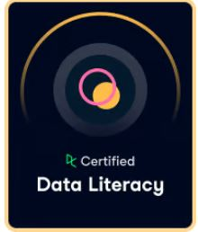
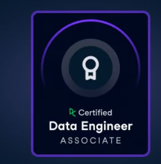

## Hi there, I'm [Rasika] 👋

<!--  For an ampersand (&), use &amp; (e.g., Analytics+%26+Optimization) -->
  

<!-- 🔗 Update these links with your own social media and contact information -->

  <a href="https://linkedin.com/in/<!-- 🔗 Update these links with your own social media and contact information -->

  
  <!-- -->
  

## 🚀 About Me 
I'm a data analyst passionate about helping businesses make sense of their data. 
I enjoy transforming complex, messy datasets into clear stories and actionable insights.

# 🏆 Achievements  
 

 

<!-- 🌐 Replace "your-username" with your actual GitHub username -->
### [🏆 Check Out My Full Portfolio Website](datascienceportfol.io/16rasika)
      
## 🔭 What I'm Currently Doing 

- **Preparing Data Analyst Certification from Datacamp:** [Completed different tracks to improve my proficiency in data field]  
- **Power-BI Project:** [Creating an interactive dashboard in Power BI.]
- **Developing skills in AI & Data field through different online platforms :** [e.g.Forage, CadetX, Datacamp]

<!--## 🌱 Currently Learning 

- [A new skill or technology you're exploring, e.g., Advanced machine learning techniques in Scikit-learn.]
- [Another skill, e.g., Cloud data warehousing with Google BigQuery.]-->

## 🛠️ Technical Skillset

<!-- This section uses Shields.io badges. You can customize them or create your own!-->

#### Data Analysis & Visualization

  <!-- 💡 Go to Shields.io to create your own badges -->
  
  
  
  

#### Programming & Automation

  
  

#### Business Intelligence & Analytics

  
  
  
  

#### Machine Learning 

  
  
  
  

  

</a>
 <!--  -->
  

